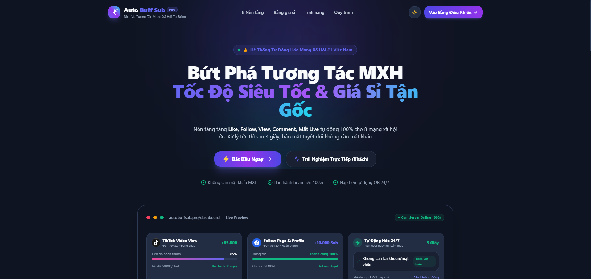

# ⚡ AutoBuffSub — Nền Tảng Tăng Trưởng Tương Tác Mạng Xã Hội Tự Động

> *"Giải pháp tăng tương tác đa kênh toàn diện — Tự động, Nhanh chóng, An toàn và Hoạt động 24/7."*

---

## 🌟 Giới Thiệu Dự Án

**AutoBuffSub** là nền tảng Web App dịch vụ mạng xã hội hiện đại, được xây dựng nhằm cung cấp giải pháp tăng trưởng tương tác trực tuyến toàn diện, nhanh chóng và tự động hóa cho các nhà sáng tạo nội dung, cá nhân kinh doanh online, agency và thương hiệu.

Với giao diện được thiết kế trực quan, hiện đại và tối ưu trải nghiệm đa thiết bị, người dùng có thể dễ dàng tiếp cận hàng trăm gói dịch vụ chất lượng cao, nạp tiền tự động qua mã QR ngân hàng và theo dõi tiến độ đơn hàng theo thời gian thực một cách minh bạch.

---

## 🚀 Hệ Sinh Thái Dịch Vụ Đa Nền Tảng

AutoBuffSub hỗ trợ đầy đủ các mạng xã hội phổ biến nhất hiện nay:

* 📘 **Facebook:** Tăng Like bài viết, Follow trang cá nhân / Fanpage, Mắt xem Livestream, Lượt xem Video Reels / Watch, Bình luận (Comment) tự động và Chia sẻ (Share) bài viết.
* 🎵 **TikTok:** Tăng Follower kênh, Tim (Like) video, Lượt xem (Views) video lên xu hướng, Mắt xem Livestream, Lưu bài viết và Chia sẻ video.
* 📸 **Instagram:** Tăng Người theo dõi (Followers), Tim bài viết, Lượt xem Story / Reels, Bình luận tương tác tự nhiên.
* 🔴 **YouTube:** Tăng Người đăng ký (Subscribers), Lượt xem video (Views) chất lượng cao, Like video, Giờ xem hỗ trợ bật kiếm tiền.
* 💬 **Telegram, Threads & Khác:** Hỗ trợ tăng thành viên nhóm, lượt xem bài đăng kênh và tương tác đa nền tảng.

---

## ✨ Điểm Nhấn & Tính Năng Nổi Bật

### 1. ⚡ Đặt Đơn Siêu Tốc — Tự Động Khởi Chạy
* **Quy trình 3 bước đơn giản:** Chọn nền tảng ➔ Dán link trang cá nhân/bài viết ➔ Nhập số lượng và xác nhận.
* Hệ thống tiếp nhận và phân phối đơn hàng tự động ngay lập tức, không cần thao tác thủ công.

### 2. 💳 Nạp Tiền Tự Động 24/7 Qua Mã QR Ngân Hàng
* Hỗ trợ tạo mã VietQR thanh toán chuẩn xác đến từng đồng.
* Tiền cộng vào ví tài khoản chỉ trong 3 - 5 giây sau khi chuyển khoản thành công.
* Hạn mức linh hoạt, hỗ trợ nạp chỉ từ **5.000 ₫**.

### 3. 📊 Theo Dõi Tiến Độ Đơn Hàng Thời Gian Thực (Live Tracking)
* Bảng quản lý đơn hàng chi tiết: Mã đơn, tên dịch vụ, link mục tiêu, số lượng đã chạy, số lượng còn lại và trạng thái (`Đang xử lý`, `Hoàn thành`).
* Tính năng làm mới trạng thái tức thì giúp người dùng kiểm soát hiệu quả chiến dịch.

### 4. 🎨 Giao Diện Công Nghệ Đỉnh Cao (Modern Sleek UI/UX)
* **Dark Mode & Light Mode:** Tùy chọn giao diện Tối hoặc Sáng bảo vệ mắt và tối ưu thẩm mỹ.
* **Tương thích hoàn hảo trên mọi thiết bị:** Trải nghiệm liền mạch trên Máy tính (Desktop), Máy tính bảng (Tablet) và Điện thoại di động (Mobile với Bottom Sheet tiện lợi thao tác bằng một tay).
* **Bảng giá trực quan:** Tra cứu danh mục, lọc theo nền tảng, xem chi tiết mô tả và tốc độ ước tính của từng máy chủ dịch vụ.

### 5. 🛡️ An Toàn & Bảo Mật Tuyệt Đối
* Cam kết **100% không yêu cầu mật khẩu** hay quyền truy cập vào tài khoản mạng xã hội của người dùng.
* Mọi giao dịch và dữ liệu cá nhân được mã hóa và bảo mật nghiêm ngặt.

---

## 🌐 Trải Nghiệm Trực Tuyến

* 🔗 **Live Website:** [https://auto-buff-sub.vercel.app/](https://auto-buff-sub.vercel.app/)
* 💻 **GitHub Repository:** [https://github.com/s0nbuildtech287/AutoBuffSub](https://github.com/s0nbuildtech287/AutoBuffSub)
